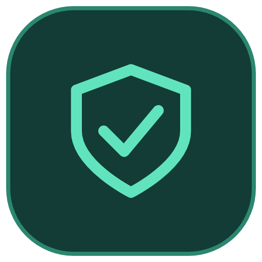
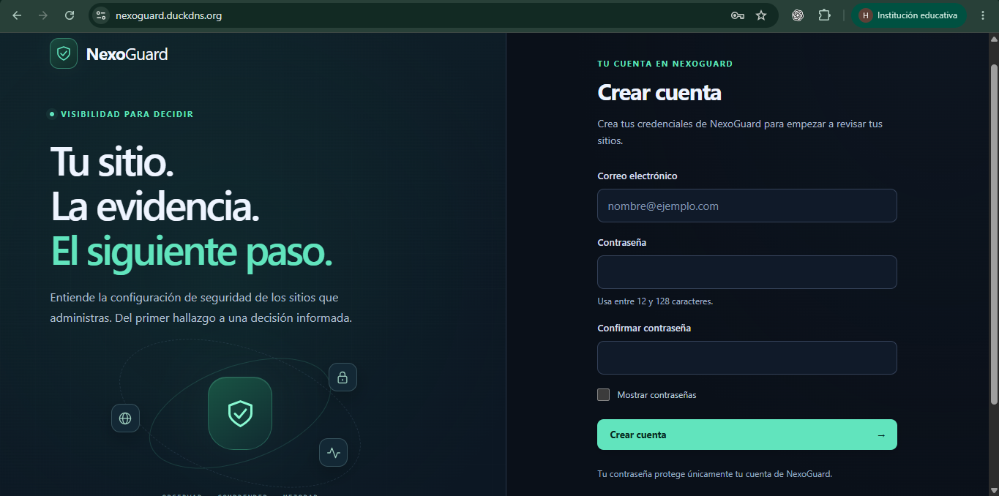

# NexoGuard — Backend



NexoGuard es una aplicación universitaria para que los propietarios de sitios web revisen configuraciones observables de seguridad, consulten evidencia y comprendan cómo corregir los hallazgos. El análisis se limita a sitios cuya propiedad se ha verificado; no es una prueba de penetración ni garantiza la ausencia de vulnerabilidades.

- **Aplicación desplegada:** https://nexoguard.duckdns.org
- **Frontend complementario:** https://github.com/IsaacEspinoza0406/nexoguard-frontend

## Vista previa



Captura real del frontend; no representa resultados de análisis ni contiene datos de una cuenta.

## Funcionalidades implementadas

- Registro de cuentas con normalización del correo, contraseña de 12 a 128 caracteres, Argon2id y control de duplicados. El registro no inicia sesión automáticamente.
- Login, consulta del usuario autenticado y logout con sesiones revocables almacenadas en MySQL, caducidad absoluta y por inactividad.
- Registro y listado de sitios del usuario. El backend comprueba propietario en las operaciones protegidas.
- Verificación mediante un archivo HTTPS en `/.well-known/nexoguard-verification.txt`: desafío aleatorio de 30 minutos y propiedad válida durante 30 días. Cada subdominio requiere su propia prueba; renovar invalida la anterior.
- Análisis manual de la página principal: redirección HTTP, HTTPS, certificado, caducidad, HSTS, CSP, protección frente a marcos, `nosniff`, política de referencia y atributos Secure, HttpOnly y SameSite de las cookies recibidas.
- Persistencia de análisis, evidencia mínima, recomendaciones con acción correctiva y comprobación, historial y comparación de dos análisis del mismo sitio y revisión de dominio.
- Programación diaria o semanal, activada expresamente por el propietario. Alertas dentro de la aplicación por regresiones comparables y proximidad del vencimiento del certificado; el umbral inicial configurable es de 30 días.
- Integración complementaria con SSL Labs: consentimiento explícito, cuotas, espera, estados e informes guardados con procedencia y fechas. Un fallo de actualización no elimina el informe conservado ni bloquea los resultados propios.
- Contrato OpenAPI/Swagger configurable, comprobaciones de salud y recuperación de trabajos interrumpidos.

Los resultados distinguen `APROBADO`, `HALLAZGO`, `NO_APLICABLE` y `NO_EVALUADO`. La comparación muestra mejoras, empeoramientos, igualdad o falta de comparabilidad; no asigna una puntuación global. Una CSP presente se conserva como `NO_EVALUADO`: su presencia no demuestra que su política sea eficaz.

## Stack y arquitectura

Node.js 24, TypeScript, NestJS, Prisma ORM 7.10.1 con `@prisma/adapter-mariadb`, MySQL 8.4, Argon2, Axios, programación con NestJS y OpenAPI/Swagger. Jest, ESLint y TypeScript proporcionan las comprobaciones automatizadas. Docker construye las imágenes de ejecución.

La arquitectura separa presentación HTTP y DTO, aplicación y casos de uso, dominio e infraestructura. Prisma se comparte mediante inyección de dependencias y gestiona conexión y cierre; las peticiones no crean un cliente nuevo. En producción, las conexiones a destinos analizados se delegan a un transporte aislado.

```text
src/
  main.ts                       Arranque, validación, CORS y salud
  app.module.ts                 Composición de módulos
  users/                        Registro de cuentas
  auth/                         Sesiones, login, logout y autorización
  sites/                        Sitios y verificación de propiedad
  analysis/                     Motor, resultados, comparación y monitoreo
  infrastructure/prisma/        Configuración y servicio de persistencia
  transport/                    Transporte de red separado
  security/                     Controles HTTP, proxy y eventos
  documentation/                Contrato OpenAPI
  generated/prisma/             Cliente generado; no se versiona
prisma/
  schema.prisma                 Modelo de datos
  migrations/                   Migraciones oficiales
docker/                         Imágenes, migración y operación
test/                          Pruebas de integración y soporte
```

El modelo tiene diez tablas de aplicación: usuarios, sesiones, sitios, revisiones y verificaciones de dominio, análisis, resultados de comprobación, programaciones, alertas y coordinación del proveedor externo. Prisma mantiene además sus metadatos de migraciones.

## TLS: implementación y alcance

La versión preparada incorpora HTTPS en los saltos Nginx → Next.js, Nginx → NestJS y Next.js SSR → NestJS, con CA web independiente y SAN `front`/`back`. **No se ha desplegado esta actualización en EC2**: no se debe confundir el HTTPS público existente con los saltos internos de la versión anterior, que utilizaban HTTP.

| Conexión | Versión preparada | Validación |
| --- | --- | --- |
| Navegador → Nginx | HTTPS público; HTTP redirige salvo ACME/salud | Certificado público, TLS 1.2/1.3 |
| Nginx → Next.js / NestJS | HTTPS interno | CA web, SNI y nombre explícitos; fallo cerrado |
| Next.js SSR → NestJS | `https://back:3001` | CA adicional al arrancar Node y nombre de servidor |
| NestJS → MySQL | TLS, CA propia y nombre esperado | `production_tls`, identidad y transporte seguro |
| NestJS → transporte | HTTPS autenticado | CA y nombre; HTTP privado desactivado en EC2 |
| Transporte → servicios HTTPS | TLS estricto | CA, nombre, DNS fijado y límites de red |
| Prueba anónima HTTP del sitio | HTTP:80 intencional | Solo evalúa redirección, sin cookies ni credenciales |

[internal-tls.ts](./src/security/internal-tls.ts) configura HTTPS nativo en NestJS y bloquea producción sin certificado/clave. La CA privada web nunca se monta en la aplicación. El [ejemplo Compose](./docker/ec2/compose.tls.example.yaml) incluye los nuevos montajes y healthchecks HTTPS. El [overlay para EC2 existente](./docker/ec2/compose.internal-tls.yaml) selecciona backend, frontend, gateway y transporte corregidos; la imagen de migración permanece como herramienta explícita, sin iniciarla.

El [procedimiento completo](./docker/ec2/INTERNAL_TLS.md) describe generación privada, permisos, SAN, renovación, imágenes, respaldo cifrado, despliegue manual y reversión sin migraciones ni cambios de datos. Mantiene MySQL y sus datos intactos; conserva la configuración TLS/RPC del transporte al actualizar su imagen. La [renovación automática preparada](./docker/ec2/RENEWAL.md) usa systemd, hojas de 90 días y margen de 30 días, con validación, diario y reversión. Aún no está instalada en EC2; no se confunde con ACME público. La [corrección compatible de Effect y separación del runtime](./docker/ec2/DEPENDENCIES.md) elimina los tres avisos altos observados en la nueva entrega; quedan 18 moderados de desarrollo, sin afirmar una auditoría completa.

### Diagnóstico de certificados del analizador

[AnalysisNetwork](./src/analysis/infrastructure/analysis-network.ts) conserva una excepción limitada al handshake diagnóstico para observar certificados inválidos como hallazgos. Comprueba por separado identidad/confianza y no envía solicitudes HTTP, cookies, autorización ni datos de aplicación en ese handshake. [ManualEngine](./src/analysis/application/manual-engine.ts) no descarga contenido HTTPS cuando la confianza o identidad fallan; las descargas posteriores siempre validan TLS. No es una desactivación para tráfico de aplicación ni un falso positivo genérico.

### Guías prácticas

El catálogo `practical-v1` de [practical-guides.ts](./src/analysis/domain/practical-guides.ts) cubre las doce comprobaciones con ubicaciones orientativas, ejemplos o procedimientos, cautelas y verificación. Complementa `catalog-v1`, sin cambiar reglas `manual-v1`, evidencia, fechas ni resultados históricos. La tecnología la elige el usuario. Los ejemplos HSTS de 300 segundos y las cookies `nexoguard_demo` son de laboratorio. CSP requiere revisión contextual; una plantilla Report-Only no equivale a una política aplicada ni a una comprobación aprobada.

Las pruebas [TLS de red](./test/tls-network.spec.ts) necesitan Node 24.5+ y OpenSSL 3; `NEXOGUARD_TEST_OPENSSL` permite indicar el ejecutable. [ec2-https.integration.mjs](./test/ec2-https.integration.mjs) solo debe ejecutarse con la fixture aislada: registra cuentas ficticias y escribe en su MySQL nuevo. No utilizarlo contra producción. La fixture visual [practical-ui.fixture.mjs](./test/practical-ui.fixture.mjs) usa datos simulados y no prueba persistencia ni seguridad TLS.

## Requisitos y configuración local

Se requieren Node.js 24, npm, MySQL 8.4 previamente preparado y Docker con contenedores Linux si se usa la topología en contenedores. Instalar paquetes o generar Prisma Client **no crea ni migra la base**.

Desde este repositorio, en PowerShell, crea una configuración privada sin sobrescribir una existente:

```powershell
if (-not (Test-Path .env)) { Copy-Item .env.example .env }
npm ci
npm run prisma:generate
```

Edita `.env` en tu equipo. La [plantilla pública](./.env.example) solo contiene ejemplos; su URL de conexión no es una configuración lista para arrancar.

| Configuración | Uso |
| --- | --- |
| `DATABASE_URL` | Conexión privada del runtime. Nunca se envía al frontend. |
| `NEXOGUARD_DB_MODE` | `local_unencrypted` únicamente en la red Docker local aislada; `production_tls` para producción. |
| `NEXOGUARD_DB_PUBLIC_KEY_FILE` | Archivo con la clave pública RSA de MySQL para autenticación local; no habilitar recuperación automática de claves. |
| `NEXOGUARD_HTTP_MODE`, `FRONTEND_ORIGIN` | En local: `local` y `http://127.0.0.1:3000`. |
| `HOST`, `PORT` | Escucha de NestJS; por defecto `127.0.0.1:3001`. Dentro del contenedor se necesita `HOST=0.0.0.0`. |
| `SESSION_ABSOLUTE_SECONDS`, `SESSION_IDLE_SECONDS` | Caducidad de sesión; la plantilla establece ocho horas y treinta minutos. |
| `NEXOGUARD_CERT_WARNING_DAYS` | Ventana de aviso del certificado; inicialmente 30 días. |
| `NEXOGUARD_SWAGGER_ENABLED` | Habilita documentación; desactivada por defecto en modo producción. |
| `SSLLABS_ENABLED`, `SSLLABS_EMAIL` | Integración opcional. Mantener deshabilitada hasta disponer del registro del proveedor y configuración privada; nunca usar variables `NEXT_PUBLIC_`. |

El [validador de conexión](./src/infrastructure/prisma/database-config.ts) exige, en modo local, el hostname Docker `db`, puerto 3306, base `nexoguard_migration_test` y la identidad de desarrollo prevista por el código. No acepta sustituir el destino por una URL arbitraria a `localhost`. La base, sus cuentas y las migraciones deben estar preparadas antes del arranque; la clave pública del servidor debe estar disponible en la ruta configurada. No emplees este modo sin TLS fuera de desarrollo aislado.

Con esas condiciones satisfechas desde el entorno donde se ejecuta Node:

```powershell
npm run build
npm start
```

La API escucha en el puerto 3001. Para alojar el backend en la misma red Docker que MySQL puede construirse su imagen:

```powershell
docker build --platform linux/amd64 -t nexoguard-back:local .
```

El contenedor necesita la configuración privada, acceso al servicio `db` y montaje de solo lectura de la clave pública. Publica el puerto local únicamente en la interfaz de bucle local y usa `HOST=0.0.0.0` dentro del contenedor. El Dockerfile no incluye los archivos `.env` privados. La orquestación conjunta se administra separadamente y no viene incluida en los repositorios de aplicación; construir esta imagen no inicia MySQL ni prepara su esquema.

## Migraciones y permisos

El esquema y el SQL oficiales se conservan en [Prisma](./prisma/). El arranque del runtime no ejecuta migraciones. La identidad del runtime debe tener solo permisos de aplicación; migraciones, administración y respaldos utilizan identidades independientes.

El ejecutor [docker/migrate.mjs](./docker/migrate.mjs) requiere `NEXOGUARD_MIGRATION_DATABASE_URL` con la cuenta de migración esperada, destino validado y `NEXOGUARD_MIGRATION_APPROVED=yes`. Se ejecuta como una tarea explícita, nunca desde cada réplica del backend. Antes de autorizarlo deben comprobarse destino, permisos y respaldo; no reutilices la URL del runtime ni apliques migraciones a una base existente solo para probar el proyecto.

## Comandos de validación

Los siguientes scripts están definidos en [package.json](./package.json):

```powershell
npm run prisma:validate
npm run prisma:generate
npm run lint
npm run typecheck
npm run test
npm run build
```

Los comandos Prisma leen la configuración de entorno. Las pruebas con dobles o respuestas de red controladas no demuestran por sí solas persistencia MySQL, DNS público ni funcionamiento de un proveedor externo. Las comprobaciones con datos reales deben realizarse en un entorno autorizado y aislado. Esta actualización del README no supone una nueva ejecución de pruebas.

## API y controles de acceso

Las rutas de NestJS no incluyen el prefijo del proxy. En el despliegue público se accede a ellas mediante `/api`.

| Ruta de API | Finalidad |
| --- | --- |
| `GET /users/registration-token`, `POST /users` | Token CSRF y registro de cuenta |
| `GET /auth/csrf`, `POST /auth/login`, `GET /auth/me`, `POST /auth/logout` | CSRF y sesión |
| `GET /sites`, `POST /sites` | Sitios del propietario |
| `POST /sites/{id}/verification-challenges` | Generación o renovación del archivo |
| `POST /sites/{id}/verification-challenges/{challengeId}/check` | Comprobación de propiedad |
| `POST /sites/{siteId}/analyses`, `GET /sites/{siteId}/analyses` | Inicio e historial de análisis |
| `GET /sites/{siteId}/analyses/{id}` | Resultados y recomendaciones |
| `GET /sites/{siteId}/analyses/compare/{before}/{after}` | Comparación |
| `GET/POST /sites/{siteId}/schedule`, `GET /sites/{siteId}/alerts` | Programación y alertas |
| `POST /sites/{siteId}/alerts/{id}/read` | Marcar alerta como leída |
| `GET/POST /sites/{siteId}/ssl-labs` | Informes conservados o solicitud externa con consentimiento |

Registro acepta exclusivamente `email` y `password`: el correo se recorta y convierte a minúsculas, sin eliminar puntos o alias; la contraseña no se normaliza. Devuelve `201` e identificador, sin contraseña ni hash. Los errores distinguen entrada inválida (`400`), sesión inválida (`401`), origen/CSRF (`403`), recurso inaccesible (`404`), conflicto (`409`), límite (`429`) y fallos de servicio (`500`, `502` o `503` según operación).

El navegador envía cookies con `credentials: 'include'`. Las operaciones que modifican datos requieren origen permitido, cookie y encabezado `X-CSRF-Token`; el token caduca a los diez minutos. Tras login se obtiene un nuevo token ligado a la sesión. Producción utiliza cookies Secure, HttpOnly y SameSite Strict. No guardar identificadores de sesión, contraseñas o tokens CSRF en `localStorage`.

Con Swagger habilitado se puede consultar `http://127.0.0.1:3001/docs` y `/docs-json`. Las acciones interactivas están deshabilitadas; la documentación no omite las protecciones de la API. El [contrato OpenAPI](./src/documentation/openapi.ts) forma parte del código público.

## Despliegue actual: AWS EC2

La aplicación está publicada en **https://nexoguard.duckdns.org**, en una EC2 Ubuntu 24.04 LTS x86_64, con Docker Compose y Nginx. Nginx termina HTTPS, redirige HTTP y distribuye `/` a Next.js y `/api/` a NestJS bajo el mismo hostname. El certificado tiene renovación automática. MySQL persistente, backend, frontend y transporte mantienen puertos internos sin publicación directa a Internet.

La conexión de producción a MySQL usa TLS, CA y validación del destino. Requiere `NEXOGUARD_DB_MODE=production_tls`, `NEXOGUARD_HTTP_MODE=production`, `NEXOGUARD_DB_EXPECTED_HOST`, `NEXOGUARD_DB_EXPECTED_NAME` y `NEXOGUARD_DB_CA_FILE`, además de la URL privada del runtime. La clave CSRF de producción debe ser privada, aleatoria y de al menos 32 bytes. Solo se confía en la IP exacta comprobada del proxy mediante `NEXOGUARD_TRUST_PROXY_IP`.

Producción exige transporte separado (`NEXOGUARD_TRANSPORT_MODE=remote`) con RPC autenticado, TLS y restricciones de salida; no basta con separar contenedores. El transporte no recibe credenciales de MySQL ni de sesión. Trabajadores y programación funcionan dentro del backend, por lo que el servicio debe permanecer activo. Las tareas perdidas durante una interrupción no se acumulan; guardar una programación no acredita por sí solo una ejecución automática real en EC2.

`/health/live` comprueba el proceso y `/health/ready` la conexión MySQL; no comprueban dominios ni SSL Labs. La configuración operativa, certificados y secretos se aprovisionan separadamente y no se publican junto con el código.

## Límites y pendientes

- Solo se observa la página principal de un dominio propio verificado, con límites de tiempo, tamaño, frecuencia y concurrencia y protección frente a destinos no permitidos. No hay exploración completa del sitio ni pruebas ofensivas.
- Un error de conexión o la falta de evidencia no cuentan como comprobación aprobada ni como mejora. La nota de SSL Labs pertenece a ese proveedor y no es una puntuación de NexoGuard.
- Las alertas se consultan dentro de la aplicación; no se envían correos. No se verifica continuamente un certificado entre análisis.
- Los límites de solicitudes están en memoria por proceso. Un despliegue con varias réplicas requiere coordinación adicional; la instalación actual no acredita alta disponibilidad.
- La recuperación de contraseña desde la interfaz, la gestión administrativa de roles y una certificación de accesibilidad no se presentan como funcionalidades completadas.
- Antes de futuras migraciones deben revisarse la identidad independiente, el destino y los permisos. La configuración local no debe trasladarse sin cambios a producción; el despliegue académico no equivale a una auditoría integral de seguridad.
- **La alerta de Google Safe Browsing sigue pendiente.** Se envió un reporte de posible clasificación incorrecta; no equivale a una resolución ni a una revisión aprobada de Search Console. HTTPS y los cambios visuales no resuelven por sí solos esa alerta. No se recomienda ignorarla ni desactivar protecciones.

## Licencia

El código original de NexoGuard se distribuye bajo [Apache License 2.0](./LICENSE).
Copyright 2026 Héctor Isaac Espinoza Mendoza. Consulte también [NOTICE](./NOTICE).
Las dependencias y los componentes de terceros conservan sus respectivos avisos y licencias.
